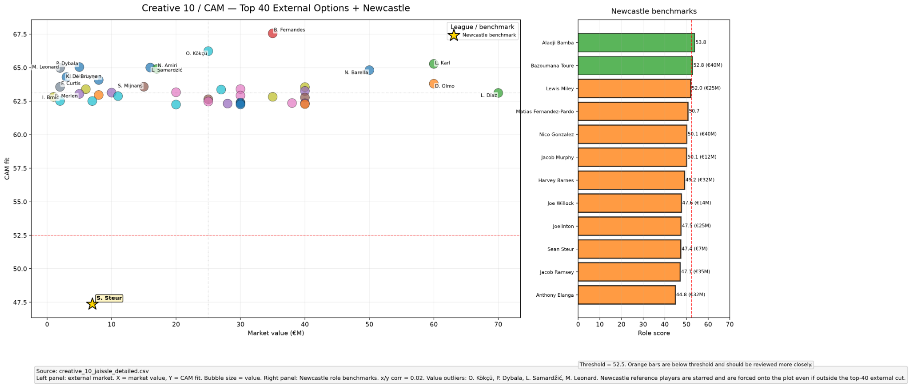
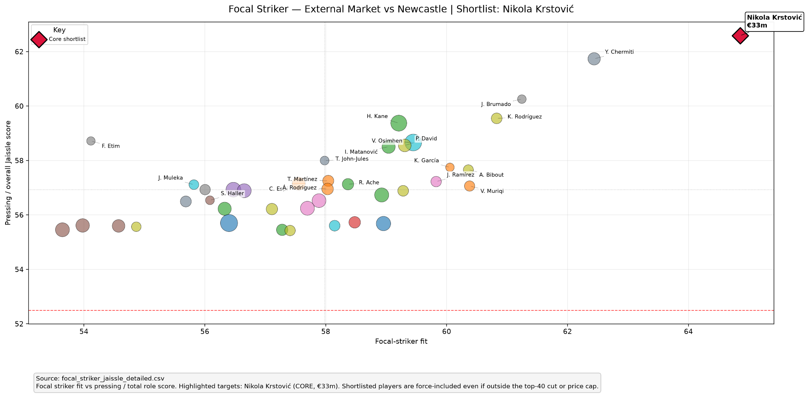
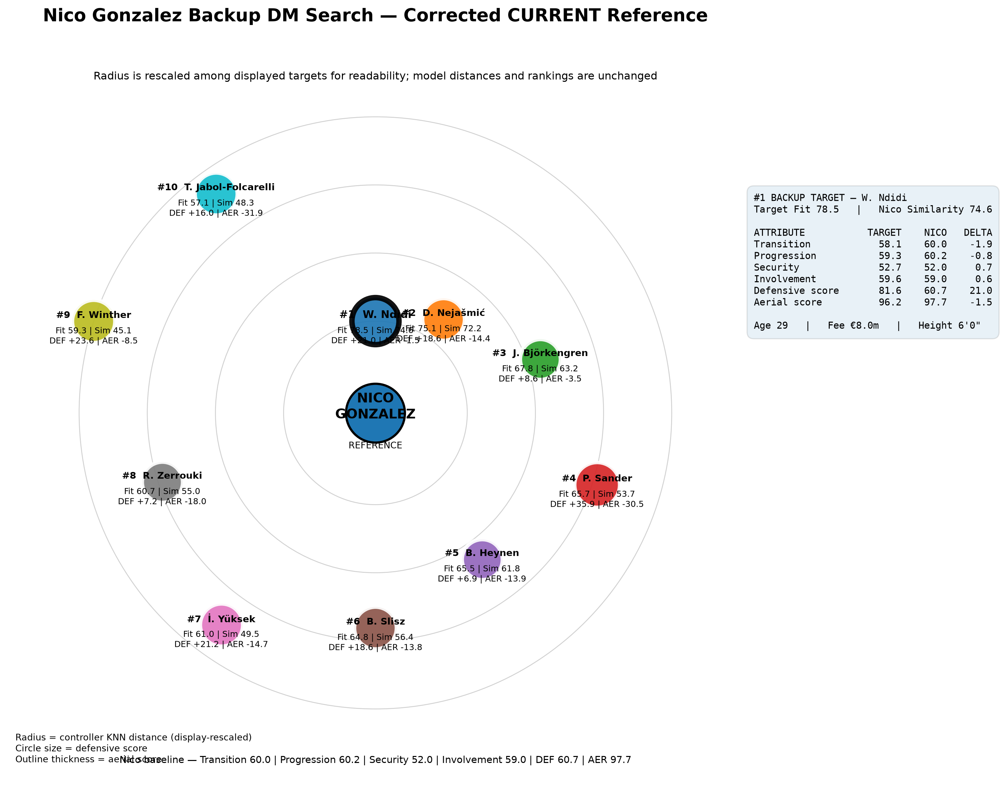
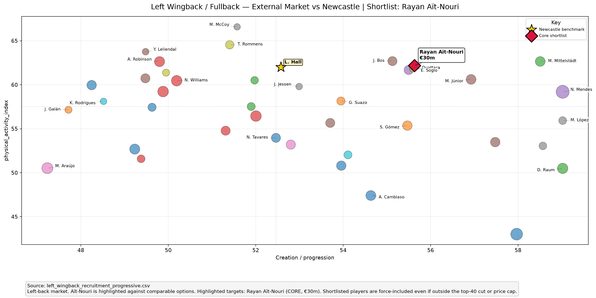
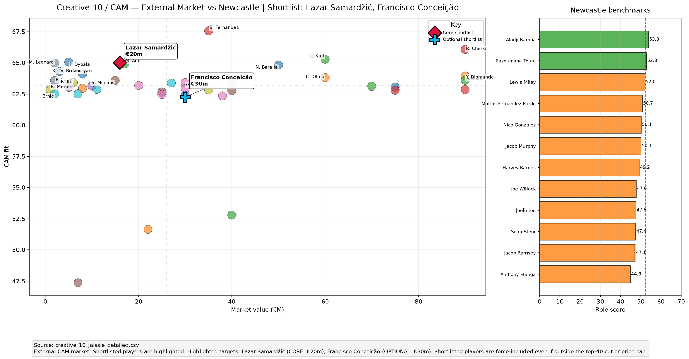
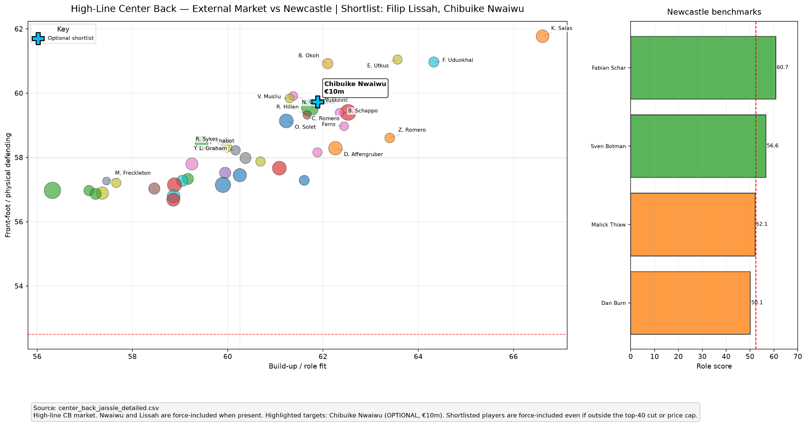
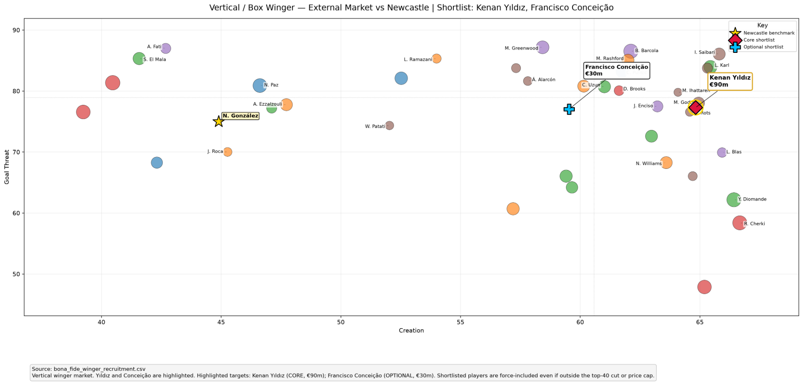

# Newcastle United Recruitment Analytics

**Translating tactical identity into data-driven squad building**

A recruitment analytics project built for the Purdue Sports Analytics Club (SAP) Fall 2026 project. Our goal was to rebuild Newcastle United around Matthias Jaissle's tactical system while working within a **$150M starting transfer budget**.

Rather than just looking for the highest-rated players, we wanted to answer a more specific question:

**Which players actually fit the way we want Newcastle to play, the roles already in the squad, and the areas where the team needs to improve?**

The project combines player data, position-specific models, similarity analysis, transfer value, tactical analysis, film, and squad-building decisions to build a realistic Newcastle recruitment plan.

---

## Project Overview

Newcastle entered the project after finishing **12th in the 2025/26 Premier League season**. Nine matches into 2026/27, the club sat 13th with a -3 goal difference.

The bigger issue was how the team was performing:

- 18th in expected goals (xG)
- 18th in expected goals against (xGA)
- 18th in possession won in the final third
- 17th in big chances created

At the same time, Matthias Jaissle had taken over a relatively young squad and brought a clear tactical identity built around:

- Vertical progression
- High-intensity gegenpressing
- Quick attacks after winning possession
- Fullbacks providing width
- Wingers attacking inside spaces
- A compact 4-4-2 defensive press

This gave us a starting point for recruitment. Instead of asking who the "best" player at each position was, we could start defining what each position needed to do in this specific team.

### Recruitment Priorities

We identified four main problems:

1. **Chance Creation** — Newcastle needed more creators from both central and wide areas.
2. **Progressive Width** — the fullbacks needed to provide progression and attacking output in possession.
3. **High Press** — recruitment needed to support the intensity of Jaissle's system.
4. **Squad Depth** — several important players had no stylistically similar replacement behind them.

Nico González and Lewis Hall were two of the clearest examples of the last problem. Both were important to the structure of the team, but replacing either one changed how Newcastle had to play.

---

## Analytical Approach

The basic idea behind the project was:

```text
Football Problem
      ↓
Define Tactical Roles
      ↓
European Player Data
      ↓
Per-90 Metrics & Positional Percentiles
      ↓
Role Fit / Jaissle Fit Models
      ↓
Player Similarity / KNN
      ↓
Age, Value & Squad Constraints
      ↓
Film + Tactical Validation
      ↓
Recruitment Decision
```

The models were meant to **reduce the search space**, while our Sports Analytics group made the final decisions as we negotiated prices with the board members of the club.

To re-emphasize, a player ranking highly gave us a reason to investigate them, but did not automatically mean we wanted to sign them because we factored in squad building based off of age, tactical system the player was coming from and how it would translate, and league strength of their league. Furthermore, I researched the player after data analysis, looking at price, contract status and expiry, current fotmob profile for 26/27, and film review to decide between players.

---

## Data & Player Profiling

The pipeline takes player-match data and turns it into comparable player profiles.

The general workflow is:

```text
Raw Player-Match Data
        ↓
Clean & Standardize
        ↓
Aggregate Match Data
        ↓
Calculate Per-90 Metrics
        ↓
Position Classification
        ↓
Position-Specific Percentiles
        ↓
Role-Specific Metrics
        ↓
Recruitment Models
```

Players are primarily compared against others who play similar positions. This helps avoid comparisons where a player looks statistically strong simply because their role gives them more opportunities to accumulate a certain action.

Per-90 statistics are calculated from aggregate minutes and actions rather than averaging individual match per-90 values.

We then use league-wide percentiles to put different metrics onto a common scale.

---

## Modeling Tactical Roles

A major part of the project was moving away from one generic player rating.

A striker, progressive fullback, high-line center back, holding midfielder, and creative winger are being asked to solve completely different problems. Even two players at the same listed position may have very different responsibilities.

We therefore created **position and role-specific models**.

### Role Fit

Role Fit measures how well a player's statistical profile matches the responsibilities we defined for a specific role.

The metrics and weights change depending on the position.

For example, the striker model used in our final recruitment analysis was:

- **30%** Focal-Striker Fit
- **25%** Box Threat
- **20%** Focal Presence
- **15%** Pressing Activity
- **10%** Link Play

This allowed us to look for a striker who fit what Newcastle needed rather than simply ranking every striker by goals.

### Jaissle Fit

We also built broader Jaissle Fit scores around characteristics that repeatedly appeared in his tactical setup.

Depending on the position, these included areas such as:

- Pressing and defensive activity
- Progression
- Ball security
- Creation
- Physical involvement
- Verticality
- Recovery activity

Role Fit and Jaissle Fit were used together. A player could be good at their position without necessarily being the type of player we wanted for Newcastle.

### K-Nearest Neighbors

For some squad problems, we were not looking for a new starter. We wanted someone who could replace an important player **without forcing the team to change its structure**.

For those cases, we used K-Nearest Neighbors (KNN) and statistical similarity.

The clearest example was finding a backup for Nico González.

Instead of searching for the highest-rated defensive midfielder, we searched for players who behaved similarly across the dimensions that made Nico important to Newcastle's buildup and transition structure while also stressing defensive production.

---

## From Model to Recruitment

One of the benefits of building the models was being able to search a much larger player pool before narrowing the results manually.

### Exploring the Market

The visualization below shows one example from the attacking-midfield search. Players were evaluated using both their position-specific performance and their fit within the tactical model.



These searches gave us a shortlist. From there, we could look more closely at individual profiles, heatmaps, tactical usage, age, physical profile, squad role, and expected transfer cost on FotMob.

That second step mattered because a one-year wonder could pollute our set, or a player who was operating on a highly efficient team having over-inflated stats because of the dominance of the team.

Again, the highest statistical score was not always the player we wanted to sign whether it was due to recent transfer situations, squad age grouping, or other factors.

---

## Example: Nikola Krstović



Striker was one of the biggest holes in the squad.

Our focal-striker model rated **Nikola Krstović at 62.58**, around 14 points above the existing Newcastle benchmark.

The model liked his combination of:

- Shot volume
- Goal threat
- Focal presence
- Box activity
- Pressing contribution

But the actual reason we wanted him went beyond the score as Newcastle needed a real starting No. 9. Adding Krstović also meant Yoane Wissa could be used more naturally as a second striker/10 rather than being forced to lead the line, while William Osula could remain a depth and development option.

**Decision:** Sign Krstović for **$33M** as the starting striker.

---

## Example: Darko Nejašmić



This was a different type of recruitment problem.

We were not trying to replace Nico González. We wanted a low-cost player who could back him up without completely changing Newcastle's midfield structure.

The KNN model identified **Darko Nejašmić** as one of the closest realistic options.

He recorded a **72.24 Nico Similarity Index**, including:

- **99.5% similarity** — Deep Involvement
- **94.8% similarity** — Transition Protection
- **83.2% similarity** — Possession Security

He also offered more defensive activity, including 6.68 recoveries and 1.76 tackles per 90.

That made him useful for two reasons. He could preserve much of Nico's controller profile when Nico was unavailable, while also giving us a slightly more defensive option when protecting transitions or closing out matches.

At only **$3M**, we thought that was a useful squad role without spending starter-level money on a backup.

**Decision:** Sign Nejašmić for **$3M** as the backup holding midfielder/controller.

---

## Example: Rayan Aït-Nouri



Aït-Nouri is a good example of why we did not treat recruitment as simply finding an "upgrade."

Lewis Hall was already one of Newcastle's most important progressive players. We did not need to replace him.

The problem was that there was very little first-team depth behind him.

Aït-Nouri gave us something slightly different:

- More aggressive attacking profile
- Strong progression
- More creation from the fullback position
- Ability to play as a LB or LWB
- Strong fit with the width required from Jaissle's fullbacks

That gives Newcastle different ways to set up the left side depending on the opponent.

Hall can remain the more balanced option. Aït-Nouri can be used when we want the left back to take on a larger attacking role. Dan Burn can still provide the more defensive alternative.

**Decision:** Sign Aït-Nouri for **$32.5M** as rotation/competition for Hall rather than as his replacement.

---

## Other Recruitment Analysis

The same process was applied across the squad.

### Attacking Midfield



### Center Back



### Winger



Each search used different role requirements rather than applying the same rating system to every position.

---

## Final Rebuild

### Outgoing — +$113.5M

| Player | Position | Fee | Reason |
|---|---|---:|---|
| Tino Livramento | LB/RB | $50M | High resale value and availability concerns |
| Joe Willock | CAM | $15M | Limited fit within the planned midfield structure |
| Harvey Barnes | LW | $37.5M | High sale value and opportunity to reshape the wing |
| Jacob Murphy | RW | $11M | Opportunity to add more right-side creation |

### Incoming — $224M

| Player | Position | Fee | Planned Role |
|---|---|---:|---|
| Kenan Yıldız | LW/CAM | $90M | Elite attacking profile / long-term centerpiece |
| Nikola Krstović | ST | $33M | Starting focal striker |
| Rayan Aït-Nouri | LB/LWB | $32.5M | Attacking LB / competition for Hall |
| Lazar Samardžić | CAM | $20M | Central creativity and progression |
| Leopold Querfeld | RCB | $18M | Young CB with progression and aerial ability |
| Bart van Rooij | RB | $13M | Balanced two-way fullback |
| Danilov Kirill Igorevich | LCB | $7.5M | Development CB |
| Ludovic Blas | RW/CAM | $6M | Low-cost creative bridge signing |
| Darko Nejašmić | CDM | $3M | Nico-style controller depth |
| Filip Lissah | RB/RCB | $1M | Young defensive depth |

### Final Budget

```text
Starting Budget          $150.0M
Player Sales            +$113.5M
Available Funds          $263.5M
Incoming Transfers      -$224.0M
--------------------------------
Remaining Budget          $39.5M
```

We intentionally did **not** spend the remaining $39.5M just because it was available.

By that point, knowing that we started with the 4th youngest squad in the Premier League according to Transfermarkt, we felt the squad with the new signing fulfilled a combination of:

- Prime-age starters
- Bridge players
- Young development players
- Better stylistic depth
- Different tactical options within the same overall system


Spending more money only made sense if it produced a meaningful upgrade, and according to the board members of the club for the general competition we would receive more points for efficiency of transfer spending.

---

## Technical Pipeline

The repository is organized around a reproducible BSD recruitment pipeline.

```text
scripts/bsd/
│
├── extract/
│   └── Data extraction and cache building
│
├── transform/
│   ├── Player-season metrics
│   ├── Position classification
│   ├── Percentiles
│   ├── Role scores
│   └── Transfer-market enrichment
│
├── analyze/
│   ├── European recruitment searches
│   ├── Newcastle squad analysis
│   └── role_scouting/
│       ├── Position-specific models
│       ├── Historical benchmarks
│       ├── Squad-depth analysis
│       └── Final shortlist analysis
│
└── visualize/
    ├── Recruitment plots
    ├── Role-model visualizations
    └── KNN / similarity visualizations
```

The canonical European recruitment rebuild follows:

```text
European Data Extraction
        ↓
Offline Player Pool
        ↓
Transfer-Market Enrichment
        ↓
European Shortlist
        ↓
Jaissle Recruitment Pipeline
        ↓
Final Recruitment Outputs
```

The master rebuild script is:

```bash
python scripts/bsd/transform/rebuild_europe_recruitment_pipeline.py
```

Individual role and recruitment scripts can also be run separately when testing or updating a specific part of the analysis.

---

## AI-Assisted Development

This project used generative AI extensively during software development.

I want to be clear about that because I do not want to present the repository as if I manually wrote every line of Python myself.

My work was primarily on the **football and analytical side of the project**. I defined what we were trying to measure, translated our tactical ideas into player roles and model requirements, decided which metrics and constraints were useful, evaluated the outputs, watched film and reviewed player usage, and made recruitment decisions based on the combination of the data and football context.

AI was used to help turn those ideas into working code, including:

- Building and restructuring Python scripts
- Implementing data-processing logic
- Debugging
- Developing and iterating on role-scoring models
- Implementing KNN and similarity analysis
- Producing visualizations
- Refactoring and organizing the final pipeline

The process was iterative. When a model returned players that did not make sense for the role we were trying to fill, I went back through the metrics, weights, filters, player data, and football reasoning and adjusted the methodology.

For that reason, I view the code as the **implementation of the analysis**, rather than the main point of the project.

The main goal was learning how to take a football question, turn it into something measurable, use data to search a large player pool, and then know when the numbers needed more context.

**README disclosure:** This README was also drafted with the assistance of OpenAI's ChatGPT using our final SAP presentation, project methodology, repository structure, visualizations, and my explanations of the project. I reviewed and directed the final content so that it reflects how the project was actually completed.

---

## Limitations

This is a recruitment model, not a replacement for scouting.

Some important limitations are:

- **Role weights are subjective.** They represent our interpretation of what matters within Jaissle's system.
- **Percentiles depend on the comparison group.** A player's ranking can change depending on league, position classification, minutes threshold, and available data.
- **Statistical similarity is not tactical identity.** Two players can produce similar numbers in very different systems.
- **League context matters.** Performance does not transfer perfectly between competitions.
- **Transfer values are estimates.** A modeled or public market value is not necessarily the price a club would actually accept.
- **Physical and off-ball behavior can be difficult to capture completely in event data.**
- **KNN finds statistical similarity, not guaranteed replacement quality.**
- **Film still matters.** Heatmaps, tactical usage, movement, role, and squad context were used to validate players before making final decisions.

The model was most useful as a way to narrow thousands of possible players into a smaller group that was worth investigating.

---

## Improvements to Look At

- The model needed more data cleaning. There were multiple cases of NaN footballing statistics that needed filling which directly impacted role score. This was in part due to the sourcing of the football data needing to be free and accessible with request limits. This is most likely why there was a highest Jaissle role fit score of ~70.0-80.0. 

---

## Team

Developed for the **Purdue Sports Analytics Club — Fall 2026 Project**.

### Project Development

This project was developed by **Naeem Bahemia**, including the tactical research, analytical methodology, data pipeline, role and similarity models, player scouting, squad construction, and final recruitment decisions. Generative AI was used extensively to assist with the software implementation, as described in the AI-Assisted Development section above.

### Final Presentation

The project was presented for Purdue Sports Analytics Club by:

- Naeem Bahemia
- Naitik Rambhia
- Sunay Konnur
- Braden Parker

The final presentation covered the project's data analysis, tactical research, squad evaluation, player scouting, and transfer-market decisions.
